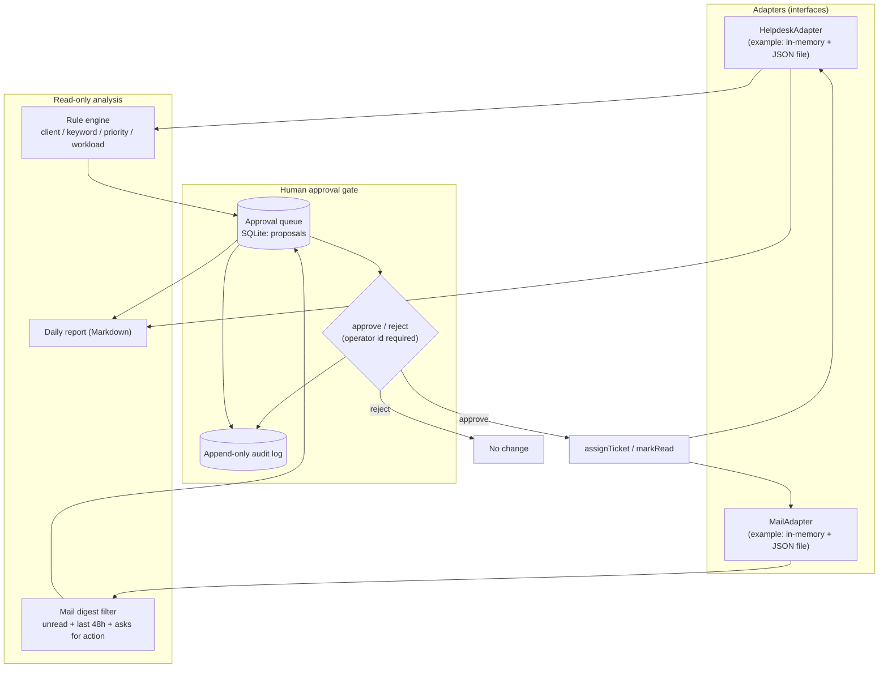

# 🎫 Helpdesk Triage Agent — Proposals First, Human Approval Before Any Change

[](https://github.com/Alemarpapa/helpdesk-triage-agent/actions/workflows/ci.yml)
[](https://www.typescriptlang.org/)
[](https://zod.dev/)
[](https://vitest.dev/)
[](https://github.com/WiseLibs/better-sqlite3)
[](LICENSE)

*Versión en español: [README.es.md](README.es.md)*

A small triage tool for a support team. It reads tickets, runs configurable rules, and **proposes** who should take each one. Nothing is assigned until a person approves the proposal from the command line. Every proposal and decision is written to an append-only audit log in SQLite.

It also builds a daily Markdown report and a mail digest that lists only unread mail from the last 48 hours that asks you to do something. Marking that mail as read is itself a proposal that needs approval.

> **Scope, honestly:** this is a portfolio project. The rule engine is deterministic (keywords, client, priority, workload). There is no LLM in it. The helpdesk and the mailbox are in-memory example adapters fed with synthetic data; it has not been connected to a real helpdesk or mail server.

---

## 🏛️ How it works



## ✨ What it does

| Capability | Behavior |
|------------|----------|
| **Rule-based proposals** | First matching rule (by client, whole-word keyword, priority) supplies candidate technicians; the one with the fewest open tickets gets the proposal. No match falls back to the whole team. |
| **Workload limits** | A technician at `maxOpenTickets` gets no more proposals. If every candidate is full, the proposal has no assignee and the approver must choose one. |
| **Approval queue** | `approve` applies exactly one proposal; `reject` needs a reason and changes nothing. A proposal can be decided once; of two simultaneous approvals only one wins. |
| **Stale-proposal check** | If the ticket was assigned or resolved after the proposal was created, approval is refused instead of overwriting newer state. |
| **Audit log** | `proposal_created`, `proposal_approved`, `proposal_applied`, `proposal_rejected`, `apply_failed`, each with actor and timestamp. SQLite triggers block `UPDATE` and `DELETE` on the table. |
| **Daily report** | Markdown: pending / in progress counts, workload per technician, unassigned tickets, proposals waiting, decisions in the last 24 hours. |
| **Mail digest** | Only unread mail from the last 48 hours, addressed To: you (not CC), not from an automated sender, containing an action cue. Approving the digest proposal marks **only the listed messages** as read. |
| **Adapters** | `HelpdeskAdapter` and `MailAdapter` are two small interfaces (`src/ports.ts`); the engine never talks to a concrete system. |

## 🚀 Quickstart

Requires Node.js 20+.

```bash
git clone https://github.com/Alemarpapa/helpdesk-triage-agent.git
cd helpdesk-triage-agent
npm install

npm run triage -- init        # copy the synthetic example data into ./data
npm run triage -- propose     # create proposals (applies nothing)
npm run triage -- approve 1 --by alex
npm run triage -- reject 2 --by alex --reason "client asked to wait"
npm run triage -- digest --for lead@helpdesk.example --now 2026-03-10T12:00:00Z
npm run triage -- report
npm run triage -- audit
```

`--now` is only read by `digest` and `report`; it is there because the example mail is dated 2026-03-10. Stored timestamps and the audit log always use the real clock.

### Example output

Real output from the commands above (trimmed):

```text
$ npm run triage -- propose
#1 [pending] assign T-1001 -> tech-lin
     why: rule 'urgent-outage'; lowest load among candidates (0 open)
#2 [pending] assign T-1002 -> tech-omar
     why: rule 'billing'; lowest load among candidates (1 open)
#3 [pending] assign T-1003 -> tech-rosa
     why: rule 'key-account-northwind'; lowest load among candidates (2 open)
...
6 proposal(s) queued. Nothing has been applied.

$ npm run triage -- approve 1 --by alex
Applied. #1 [approved] assign T-1001 -> tech-lin

$ npm run triage -- approve 1 --by alex
Error: Proposal #1 is already approved

$ npm run triage -- digest --for lead@helpdesk.example --now 2026-03-10T12:00:00Z
m-01  2026-03-10T10:30:00Z  dana.wu@blueharbor.example
     Terminal still offline  (cue: "Could you")
m-02  2026-03-09T16:00:00Z  finance@pinecrest.example
     Corrected invoice  (cue: "your approval")

Queued proposal #7 to mark these as read. Nothing is marked until you approve it.
```

Part of the generated report:

```markdown
## Workload by technician

| Technician | Pending | In progress | Open total | Limit |
|------------|--------:|------------:|-----------:|------:|
| Rosa Lima | 1 | 1 | 2 | 4 |
| Omar Haddad | 0 | 1 | 1 | 4 |
| Lin Chen | 1 | 0 | 1 | 3 |
```

### Rules file

```json
{
  "technicians": [{ "id": "tech-rosa", "name": "Rosa Lima", "maxOpenTickets": 4 }],
  "rules": [
    {
      "id": "urgent-outage",
      "when": { "priorities": ["urgent"], "keywords": ["outage", "down", "offline"] },
      "candidates": ["tech-rosa"]
    }
  ]
}
```

All conditions inside `when` must match; values inside one condition are alternatives. The file is validated with Zod: unknown condition names, duplicate technician ids and rules pointing at unknown technicians are rejected at startup. See [`examples/rules.json`](examples/rules.json).

### Tests

```bash
npm run typecheck   # strict TypeScript over src/ and tests/
npm test            # 68 Vitest tests
```

The suite covers the rule engine, the approval gate (double decisions, concurrent approvals, stale tickets, adapter failures), the append-only audit log, the digest window boundary, the report, and the CLI end to end against a temporary directory.

## ⚠️ Known limits

- **No authentication.** `--by` is a self-declared operator id. The audit log records who *claimed* to approve; it does not prove identity.
- **Example adapters only.** The JSON-file adapters are single-process (no file locking). A real helpdesk or mail adapter has to be written against `src/ports.ts`; none is included or tested.
- **Not atomic across systems.** A proposal is marked approved in SQLite, then applied through the adapter. If the adapter throws, the proposal returns to the queue and `apply_failed` is logged. If the process is killed between the two steps, the proposal stays `approved` with no `proposal_applied` entry in the audit log, and has to be checked by hand.
- **The mail filter is a keyword heuristic.** It looks for phrases such as "could you", "please <verb>", "your approval" or a question mark. It will miss indirect requests and can include rhetorical questions. English only.
- **Append-only is enforced by SQLite triggers**, which stop accidental or application-level edits. Someone with write access to the database file can still drop the triggers.

## 📁 Repository structure

```
├── examples/                # Synthetic tickets, mail and rules
├── src/
│   ├── schemas.ts           # Zod contracts: tickets, rules, mail, proposals
│   ├── rules.ts             # Pure rule engine (who should get a ticket)
│   ├── ports.ts             # HelpdeskAdapter / MailAdapter interfaces
│   ├── adapters/memory.ts   # In-memory and JSON-file example adapters
│   ├── store.ts             # SQLite approval queue + append-only audit log
│   ├── triage.ts            # Propose / approve / reject service
│   ├── digest.ts            # Mail digest filter
│   ├── report.ts            # Daily Markdown report
│   └── cli.ts               # Command-line entry point
└── tests/                   # Vitest suites
```

## 👤 Author
**Alejandro Martinez** — Technical Support & Implementation Engineer, AI Automation

## 📄 License
MIT
